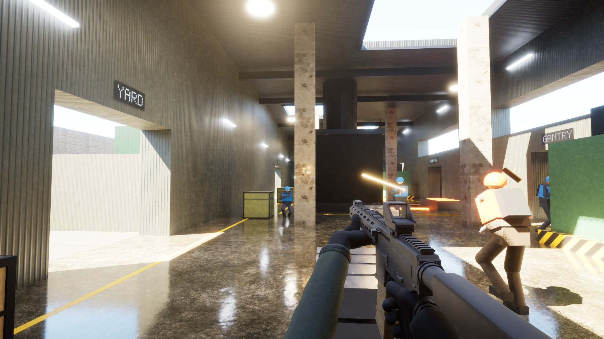
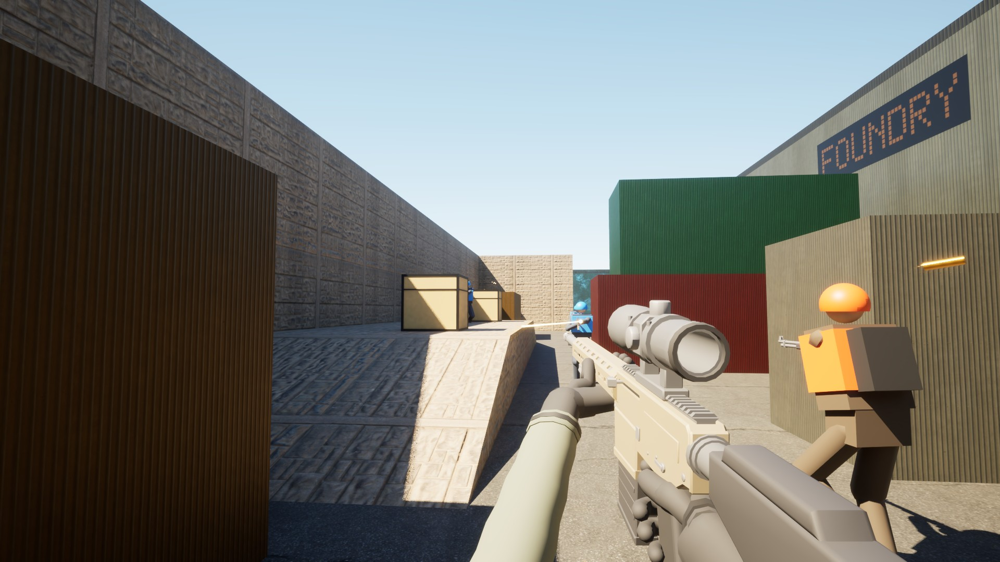
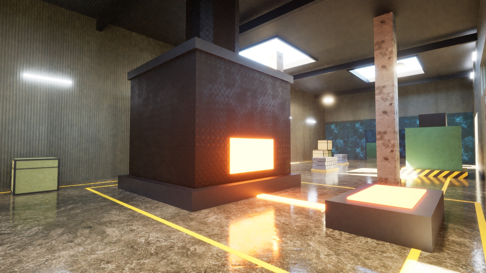
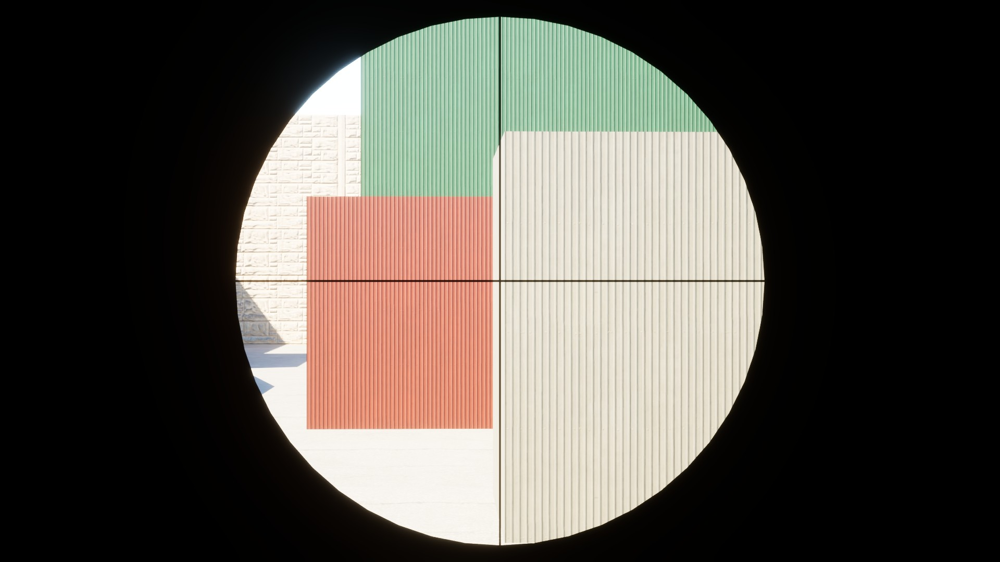
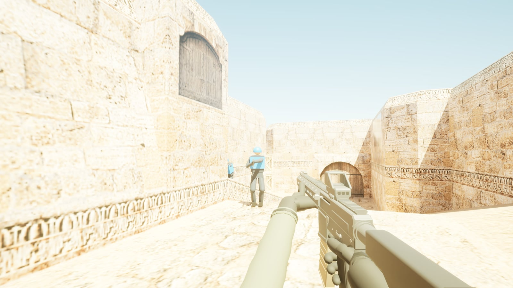
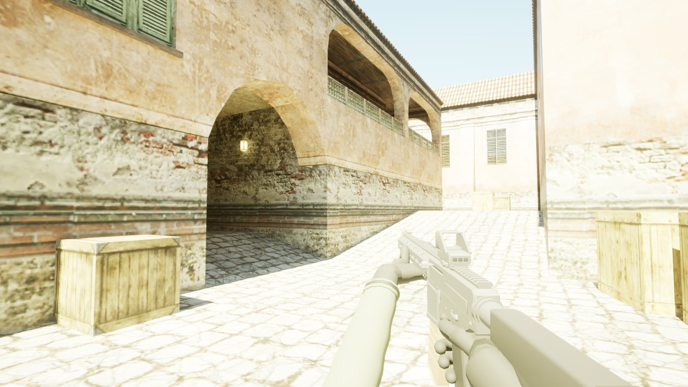
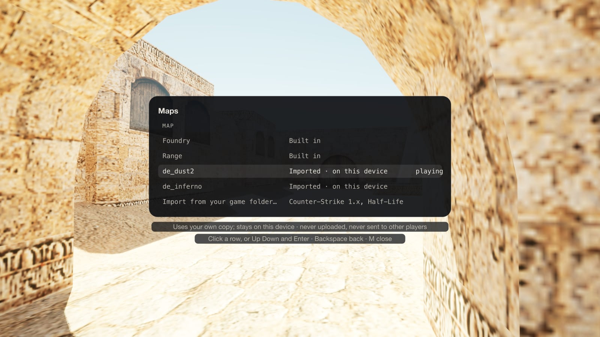
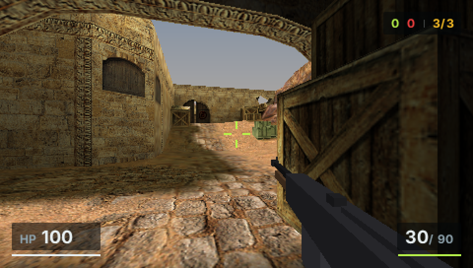

# OpenStrike — an open-source, path-traced team shooter

  

  
  
  

**OpenStrike** is a free, open-source first-person shooter in the spirit of Counter-Strike: two teams, rounds, three
weapons, a compact competitive map, and **every light ray traced in real time**. Sun through skylights, bounce light,
reflections on a wet floor and muzzle flashes that light the room are all path traced by
[ThreeRT](https://github.com/meshy-dev/ThreeRT); nothing is baked.

- **Play online in seconds:** quick play, private rooms with an invitation link, up to 10 players, team deathmatch
  or free-for-all; offline it is practice against bots.
- **Bring your own classic maps:** import **Counter-Strike 1.6 / Half-Life (GoldSrc BSP)** maps from a copy you own,
  in the game, and play them path traced. They are converted on your device and never leave it.
- **Runs where ThreeRT runs:** Mac, Windows, Steam Deck and Android, path traced on GPUs with ray tracing and
  rasterized on the rest. The **[Pocket3D port](ports/pocket3d/)** brings OpenStrike to the **PSP, PS Vita,
  Nintendo 3DS**, the iPod touch and the Nokia E7.
- **All code:** the game is TypeScript on ThreeRT's three.js-style scene API; weapons modelled in code, sounds
  synthesized in code, textures CC0. MIT licensed.

## Play

1. Install ThreeRT: **[threert.dev/download](https://threert.dev/download/)** (macOS, Windows, Steam Deck, Android).
2. Open **[openstrike.threert.app](https://openstrike.threert.app/)**, or find OpenStrikeRT in ThreeRT's store, and
   press Play. *Create room* gives you a code and a link (`https://openstrike.threert.app/#room=<CODE>`) to send to
   friends.

W A S D move · Shift sprint · C crouch · Space jump · mouse aim · left button fire · right button sights · R reload ·
1 2 3 or the wheel: weapons · Tab scoreboard · **M maps**. A gamepad works too.

## Classic maps from your own copy

  
  

Press **M** for the Maps menu and choose **Import from your game folder…**, then pick the folder of your
Counter-Strike 1.x or Half-Life installation (for example `Half-Life/cstrike`). The game lists the maps it finds,
converts the ones you choose (geometry, WAD textures, spawns, the sun, lamps and glowing textures turned into
physical lights) and keeps them in its own storage on your device. A map like de_dust2 imports in about two seconds
while the game keeps running.

  

Imported maps are yours and stay yours: nothing is uploaded, published or sent to other players. You can practise on
an imported map or open a room on it; friends who imported the same map can join, anyone else is told which map the
room plays. How the conversion works, and its limits (no `clip` brushes, nothing moves or breaks):
[docs/MAPS.md](docs/MAPS.md).

## Multiplayer

Rooms run on [threert.app](https://threert.app), and the game reaches them through the ThreeRT app it runs in
(`@threert/net`, which every ThreeRT client provides). The room is the referee: it checks every hit claim against the
weapon table, rate of fire, range and where the target was, and owns health, score and rounds. The netcode, the
cheating surface and the known limits, honestly: [docs/NETCODE.md](docs/NETCODE.md).

## Ports: PSP, PS Vita, 3DS and more

  

The game at the root of this repository is canonical: its rules, tables and maps are OpenStrike. Devices ThreeRT
cannot run on get **ports**, engines specialized for each device, in `ports/<engine>/` (the convention:
[ThreeRT's docs/PORTS.md](https://github.com/meshy-dev/ThreeRT/blob/main/docs/PORTS.md)). They are listed under
`ports` in [`threert.config.json`](threert.config.json).

| Port | Devices | Renderer |
|---|---|---|
| [`ports/pocket3d`](ports/pocket3d/) | PSP, PS Vita, Nintendo 3DS, iPod touch 4, Nokia E7, desktop (wgpu) | Pocket3D: sceGu, GXM, citro3d / PICA200, OpenGL ES 1 and 2, wgpu |

The Pocket3D builds keep their own Rust simulation and a PocketJS HUD, with offline bots and Mac–PSP crossplay; they
cook maps from your own BSPs at build time. Building them: [ports/pocket3d/README.md](ports/pocket3d/README.md).

## Repository

| Path | What |
|---|---|
| `game.ts`, `src/` | the game: player movement, weapons, the match, rooms, bots, the HUD, sound, the Maps menu |
| `src/maps/` | Foundry and Range, built in code; how any map is mounted |
| `src/import/` | the GoldSrc BSP converter, plain TypeScript that runs inside the game |
| `assets/`, `media/` | weapon models, sounds, CC0 textures; pictures |
| `tools/` | build, tests (the real game, headless), the developer's map importer, asset generators |
| `docs/` | [developing](docs/DEVELOPING.md), [maps](docs/MAPS.md), [netcode](docs/NETCODE.md) |
| `ports/pocket3d/` | the PSP / PS Vita / 3DS / iPod touch / E7 / desktop builds |

Building and testing the game from source, the launch options, the sound pipeline and releasing:
[docs/DEVELOPING.md](docs/DEVELOPING.md). In short: a ThreeRT engine checkout beside this one and ThreeRT installed,
then `node tools/setup.ts`, `node tools/build.ts`, and `threert dev` to play your changes live.

## License

MIT ([LICENSE](LICENSE)). Assets shipped with the game are original or CC0 ([assets/CREDITS.md](assets/CREDITS.md)).
OpenStrike contains no data from Counter-Strike or Half-Life; maps you import come from your own copy and stay on
your device. Counter-Strike and Half-Life are trademarks of Valve Corporation; OpenStrike is not affiliated with or
endorsed by Valve.
